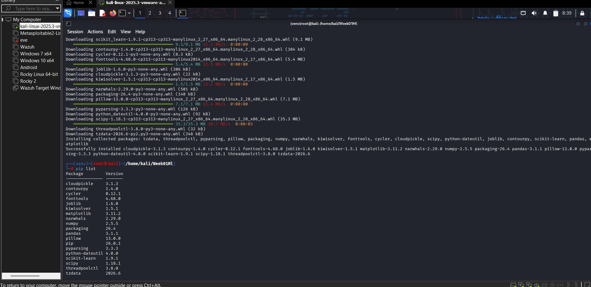
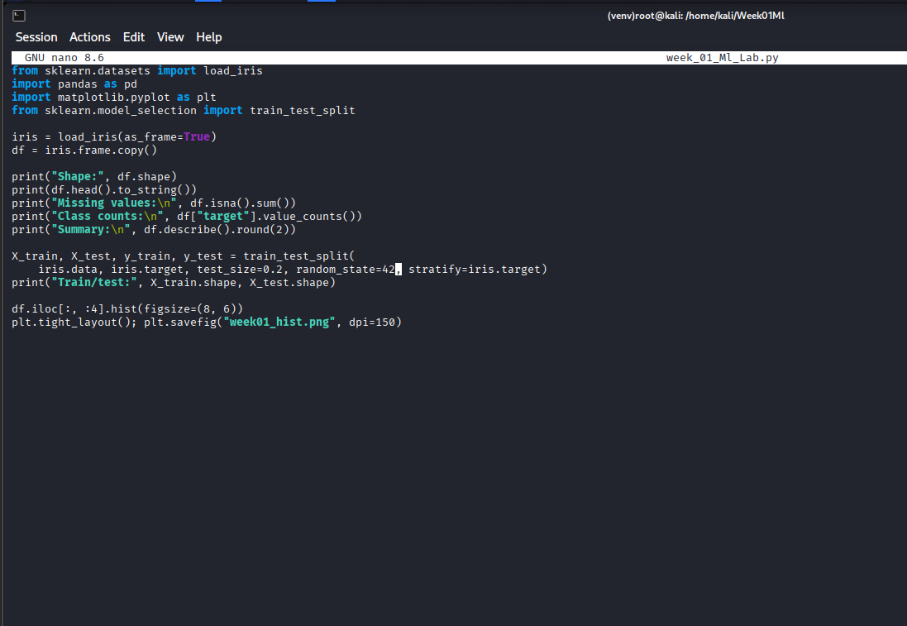
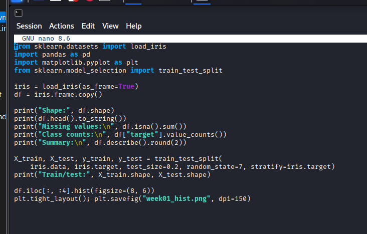
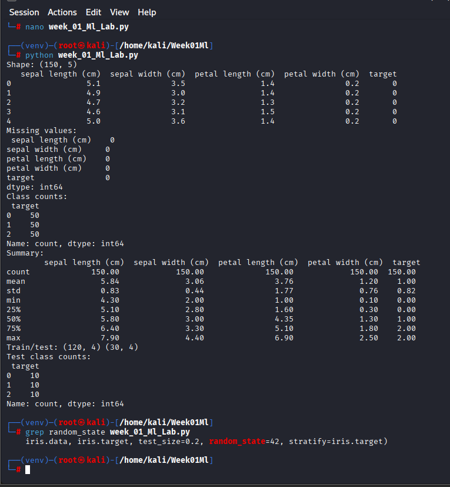
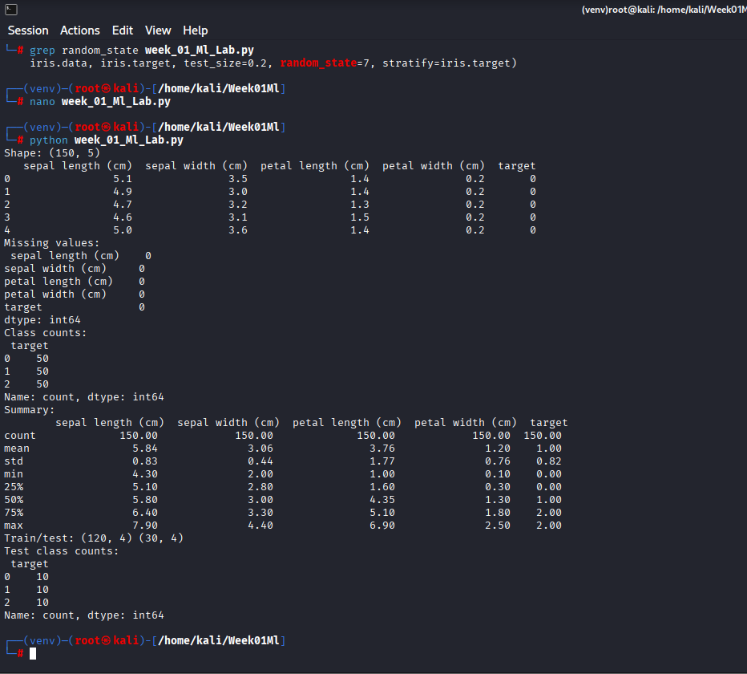
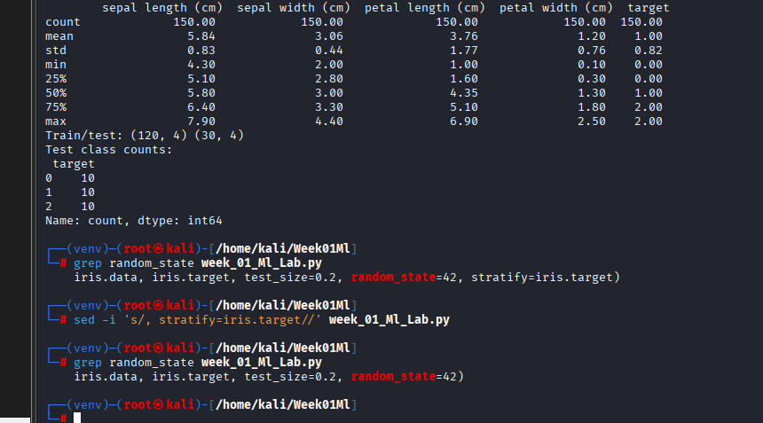
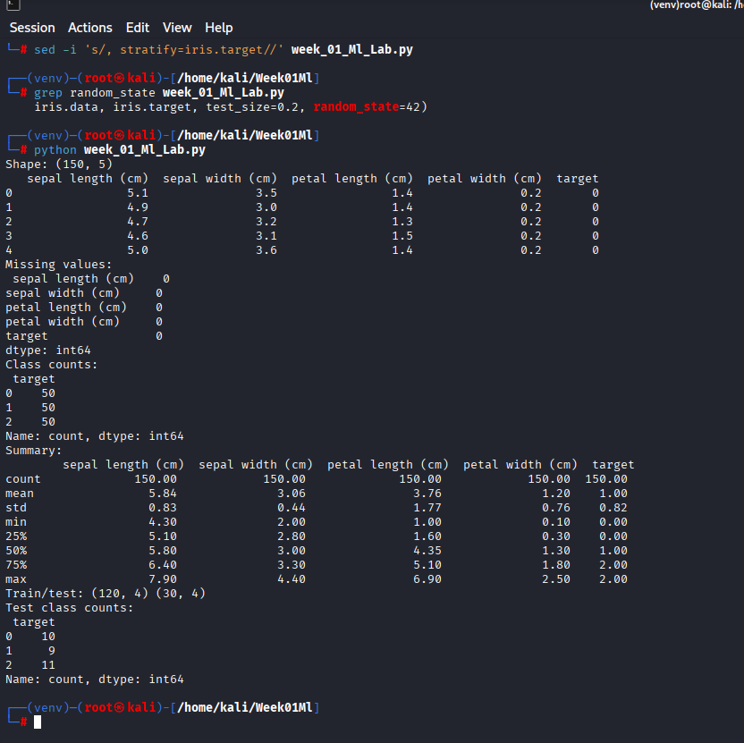

# Week 01 Practical Lab: Introduction to ML and Python
**Lab title:** Iris exploratory data analysis

| | |
|---|---|
| **Name** | Huzaifa Arif |
| **Roll No** | 132251129 |
| **Semester** | 8 |
| **Course** | Machine Learning |

---

## 1. Objective
Load the Iris dataset, inspect its dimensions and class counts, summarize the features, visualize their distributions, and split the data into train and test sets. No model is trained in this lab.

---

## 2. Names used in this submission
The names I used are slightly different from the lab sheet.

| Lab sheet | What I used |
|---|---|
| Folder `week_01` | `Week01Ml` |
| `Week_01_Lab.py` | `week_01_Ml_Lab.py` (baseline code) |
| (challenge version) | `Week_01_Challenge.py` |
| `Week_01_Report.pdf` | This `README.md` |

Other files: `week01_hist.png` (histogram saved by the code).
Environment: Kali Linux, Python 3.13.7, virtual environment (no Google Colab).

---

## 3. The seven procedural steps

### Step 1: Create the working folder
```bash
mkdir Week01Ml
cd Week01Ml
python --version
```
Created the folder and moved into it. Python 3.13.7 meets the 3.10+ requirement.

### Step 2: Install dependencies
```bash
python3 -m venv venv
source venv/bin/activate
python -m pip install numpy pandas matplotlib scikit-learn
pip list
```
A virtual environment is used because Kali blocks system-wide `pip install`. `torch` was skipped because the lab code does not use it.

### Step 3: Create the code file
```bash
nano week_01_Ml_Lab.py
```
Copied the code given in the lab sheet and saved it.

### Step 4: Run the code
```bash
python week_01_Ml_Lab.py
```
Read the output without any errors.

### Step 5: Inspect the output
- Shape: (150, 5), missing values: 0 in all columns
- Class counts: 50, 50, 50 (balanced)
- Train/test protocol: 80/20 split, `random_state=42`, `stratify=iris.target`
- Train shape (120, 4), test shape (30, 4)
- `week01_hist.png` was created (histograms of the 4 features)
- No model is trained, so there are no accuracy values to interpret.

### Step 6: One controlled change
Changed `random_state` from 42 to 7 and re-ran. Split sizes and test class counts stayed the same (see the table in section 5).

### Step 7: Challenge task
Described in section 4.

---

## 4. Challenge task
**Task:** Explain target leakage and split the data before any supervised transformations.

### (1) Hypothesis
If `stratify` is removed, the test set will no longer have exactly 10 samples per class, because the split becomes fully random. Changing `random_state` should not change the split sizes, only which samples go to the test set.

### (2) Exact code lines changed
- Step 6: `random_state=42` changed to `random_state=7`
- Challenge: `, stratify=iris.target` removed from `train_test_split(...)`
- Line added at the end of the code to see the effect:
  `print("Test class counts:\n", y_test.value_counts().sort_index())`

### (3) How I reran the experiment
- Baseline and seed 7: `python week_01_Ml_Lab.py`
- Challenge: `python Week_01_Challenge.py`

### (4) Baseline versus challenge results
See the comparison table in section 5.

### (5) Interpretation
Changing the seed from 42 to 7 did not change the split sizes or the class balance, because `stratify` kept the test set at 10 samples per class. Removing `stratify` changed the test counts to 10, 9 and 11. The total stayed 30, but the classes were no longer perfectly balanced. This shows that `stratify` keeps class proportions the same in train and test. On a small dataset like Iris the difference is small, but on small or imbalanced data an unbalanced test set could make evaluation unreliable. Since no model was trained, these results say nothing about model quality. They only show how the splitting method affects the test set.

### Target leakage explained
Target leakage means information from the test data leaks into training, which makes results look better than they really are.

| Wrong way | Correct way |
|---|---|
| Scale or transform all 150 rows, then split | Split first |
| Test data influences the mean/std used for scaling | Fit the transformation on the training set only |
| Test results look better than reality | Apply the fitted transformation to the test set |

This lab only does EDA and a split. There is no scaling or model fitting, so no leakage happens here.

---

## 5. Results comparison

| Run | random_state | stratify | Train/test shapes | Test class counts (0, 1, 2) |
|---|---|---|---|---|
| Baseline | 42 | yes | (120,4) (30,4) | 10, 10, 10 |
| Step 6 change | 7 | yes | (120,4) (30,4) | 10, 10, 10 |
| Challenge | 42 | no | (120,4) (30,4) | 10, 9, 11 |

---

## 6. Screenshots

**Screenshot 1: Environment and installed libraries**




**Screenshot 2: Dataset loading code (and train/test split code)**



**Screenshot 3: Split code with the changed seed (no model in this lab)**



**Screenshot 4: Output with results**




**Screenshot 5: Challenge modification and new result**




The histogram saved by the code is `week01_hist.png`.

---

## 7. Limitations
- Iris is a very small and easy dataset, so results can change with the seed or the split.
- Only a few settings were tested (seed 42 and 7, with and without `stratify`).
- I printed class counts but not the sample indices, so the claim that the seed changes which samples go to the test set is based on how `random_state` works, not on printed evidence.
- No model was trained, so no accuracy claims are made. Test counts of 10, 10, 10 do not prove model quality.
- No private or sensitive data was used.
